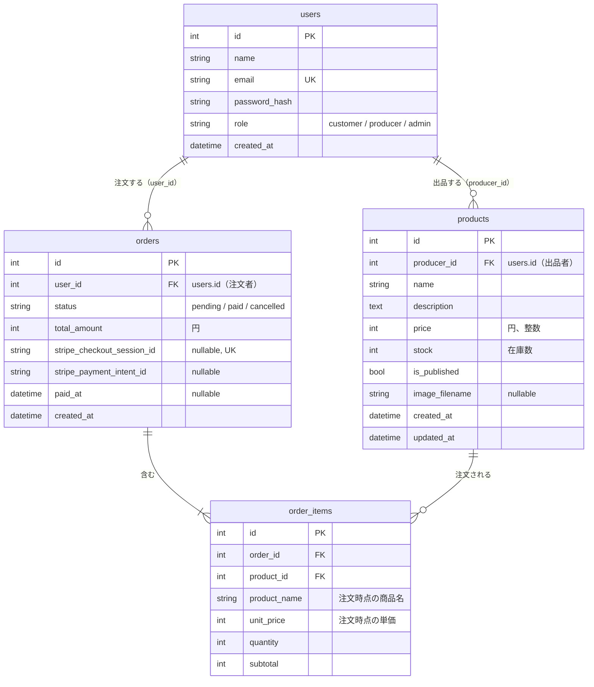

# データベース設計

[仕様書 1](../spec/01_requirements.md) のユーザーストーリー（コア）を実現するためのテーブルです。テーブル名とカラム名は [仕様書 3](../spec/03_database.md) に合わせています。DB は開発とテストが SQLite、本番が MySQL なので、SQLite でしか動かない書き方をせず、文字列のカラムには全て長さを付けます。

 

## ER 図

 

## テーブル定義

### users（スターターキットにある）

| カラム | 型 | 制約 | 説明 |
|-|-|-|-|
| id | Integer | PK | |
| name | String(50) | not null | 表示名。生産者は農園名・屋号 |
| email | String(255) | not null, unique | ログインに使う |
| password_hash | String(255) | not null | `generate_password_hash` の結果。平文は保存しない |
| role | String(20) | not null, default `customer` | `customer` / `producer` / `admin`（`Role` の StrEnum） |
| created_at | DateTime | not null | 日本時間（`now_jst`） |

### products

| カラム | 型 | 制約 | 説明 |
|-|-|-|-|
| id | Integer | PK | |
| producer_id | Integer | not null, FK users.id（restrict）, index | 出品した生産者 |
| name | String(50) | not null | 「ほうれん草 1束」のように量も入れる |
| description | Text | not null, default `""` | 紹介文（2,000字まで） |
| price | Integer | not null | 円、税込み。50〜100,000 |
| stock | Integer | not null, default 0 | いまある数。0〜999。支払いが確定したときに減らす |
| is_published | Boolean | not null, default false | 公開中か。新しく登録した商品は非公開 |
| image_filename | String(100) | nullable | サーバーで付けたファイル名（UUID + 拡張子）。写真がなければ NULL |
| created_at | DateTime | not null | |
| updated_at | DateTime | not null | 更新のたびに変わる（`onupdate=now_jst`） |

### orders

| カラム | 型 | 制約 | 説明 |
|-|-|-|-|
| id | Integer | PK | 注文番号として画面に出す |
| user_id | Integer | not null, FK users.id（restrict）, index | 注文した人 |
| status | String(20) | not null, default `pending` | `pending`（支払い待ち）/ `paid`（支払い済み）/ `cancelled`（取り消し）。`OrderStatus` の StrEnum |
| total_amount | Integer | not null | 合計（円）。サーバーが明細の小計を足して計算する |
| stripe_checkout_session_id | String(255) | nullable, unique | Checkout Session の ID。注文を作った時点ではまだないので NULL を許す |
| stripe_payment_intent_id | String(255) | nullable | 支払いが確定したときに入れる。返金（拡張 E2）で使う |
| paid_at | DateTime | nullable | 支払いが確定した日時 |
| created_at | DateTime | not null | 在庫を押さえる時間（35分）を数える起点 |

### order_items

| カラム | 型 | 制約 | 説明 |
|-|-|-|-|
| id | Integer | PK | |
| order_id | Integer | not null, FK orders.id（cascade）, index | |
| product_id | Integer | not null, FK products.id（restrict）, index | 売上の集計で `products.producer_id` と結合する |
| product_name | String(50) | not null | 注文時点の商品名。あとで商品名が変わっても注文は変わらない |
| unit_price | Integer | not null | 注文時点の単価（円）。あとで価格が変わっても注文は変わらない |
| quantity | Integer | not null | 1〜10 |
| subtotal | Integer | not null | `unit_price × quantity`（円） |

 

## 外部キーの削除時の動き

| 関係 | 削除時 | 理由 |
|-|-|-|
| orders → order_items | cascade | 明細は注文の一部なので、注文と一緒に消えてよい。SQLAlchemy 側も `Order.items` に `cascade="all, delete-orphan"` を付ける |
| products → order_items | restrict | 注文された商品が消えると、注文の記録が壊れる。注文がある商品は削除させず、非公開にしてもらう |
| users → products | restrict | コアにはユーザーを削除する機能がない。間違って消したときに、商品が一緒に消えたり、出品者が分からない商品が残ったりしないようにする |
| users → orders | restrict | 注文は売上の記録なので消さない |

コードでは `ForeignKey("products.id", ondelete="RESTRICT")` のように書く。

 

## 設計で決めたこと

- **金額は全て Integer（円）**: 日本円に小数はなく、Stripe も JPY は整数で受け取るため
- **SQLite は外部キーの制約を確かめない**: 設定しないと restrict が効かない。設定するには `PRAGMA` を使うことになるが、このプロジェクトでは使わない決まりなので、「注文がある商品は削除できない」はビューの中でも確かめる。こうすると、開発・テスト（SQLite）と本番（MySQL）で同じ動きになる
- **Session ID の unique は NULL があっても大丈夫**: SQLite でも MySQL でも、unique のカラムに NULL は複数入れられる。支払い待ちの注文がたくさんあっても重複エラーにはならない
- **生産者ごとの売上**: 1回の注文に複数の生産者の商品が入ることがある。そのため、`order_items` を `products` と結合し、`producer_id` と `status = paid` で絞って集計する
